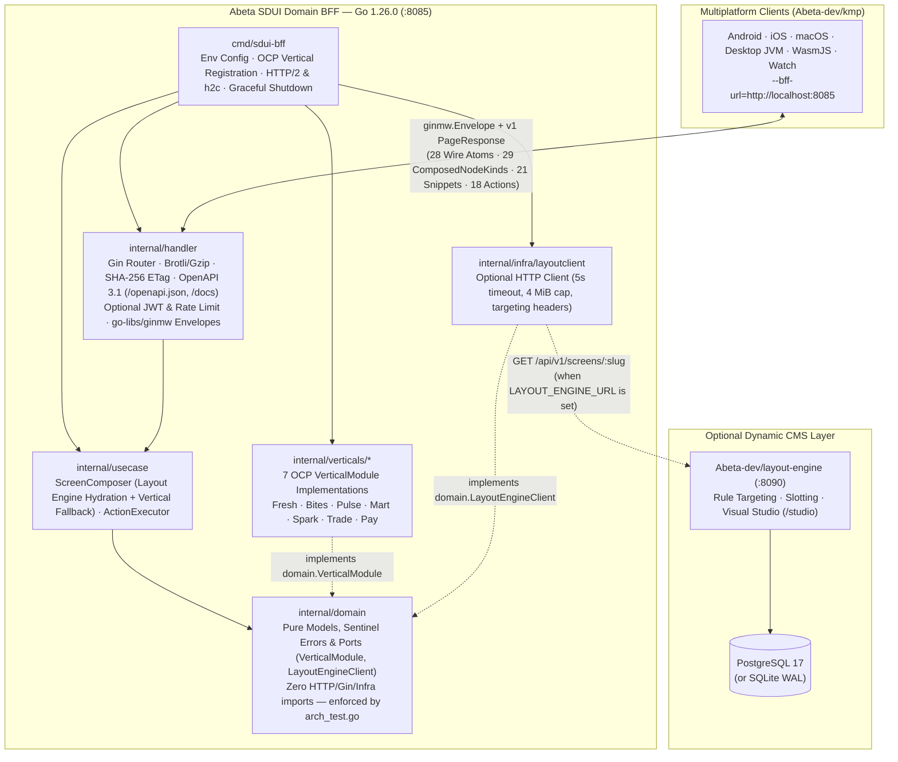
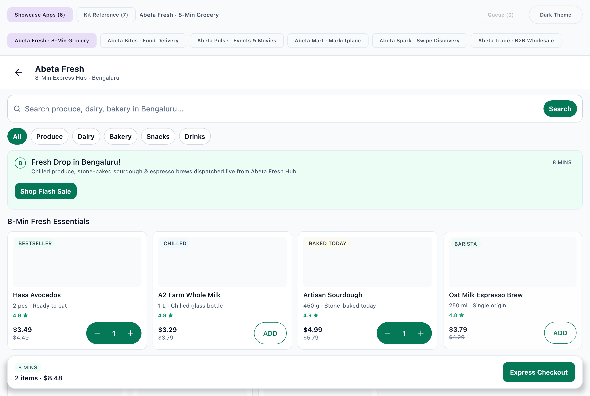
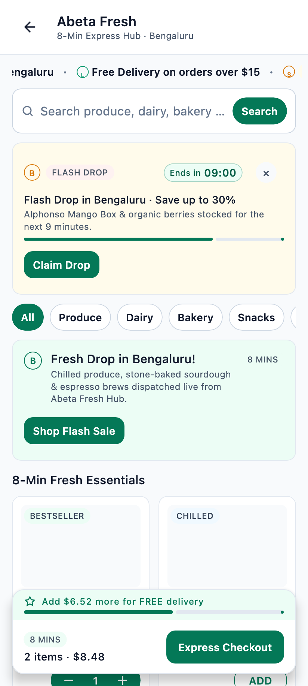
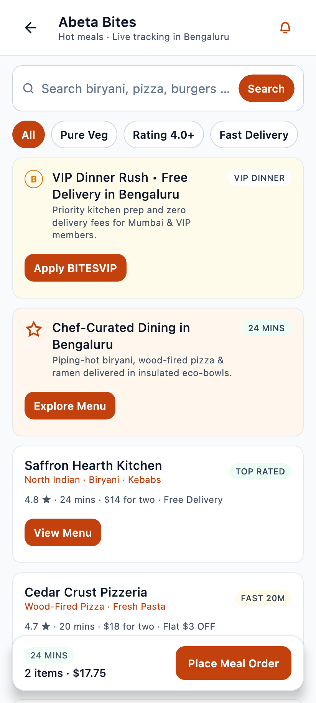
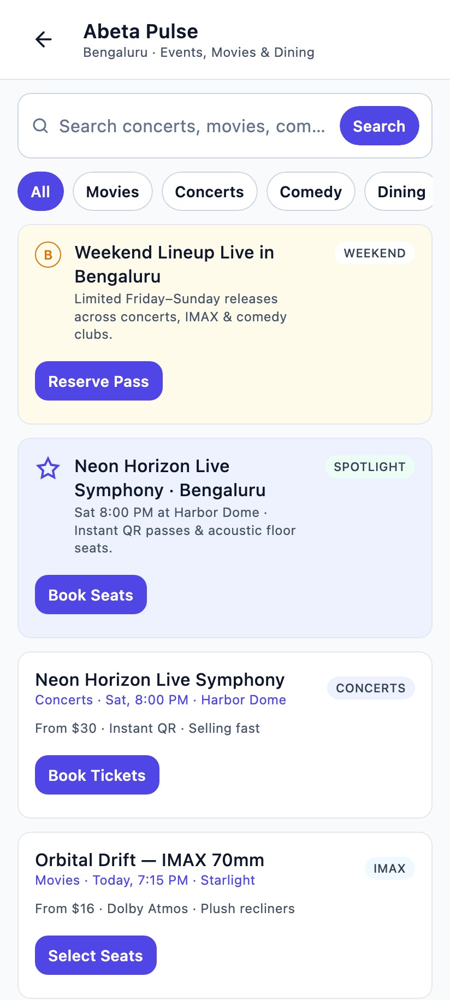
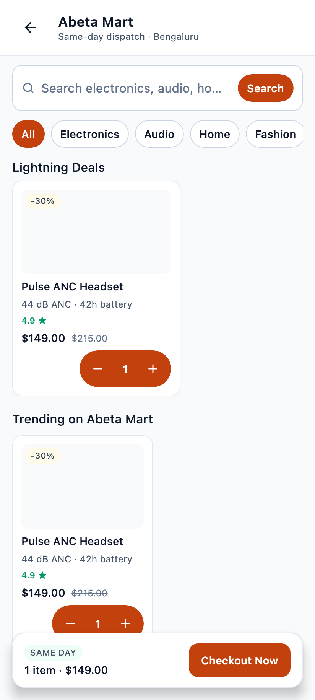
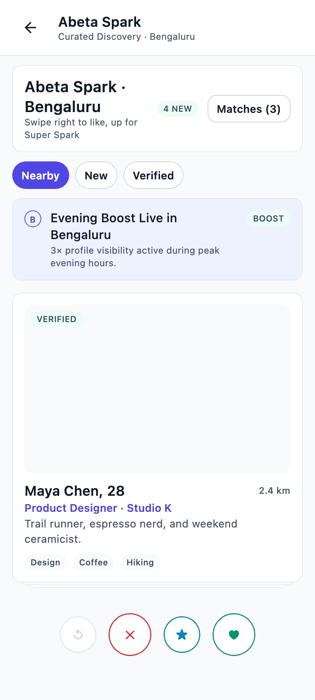
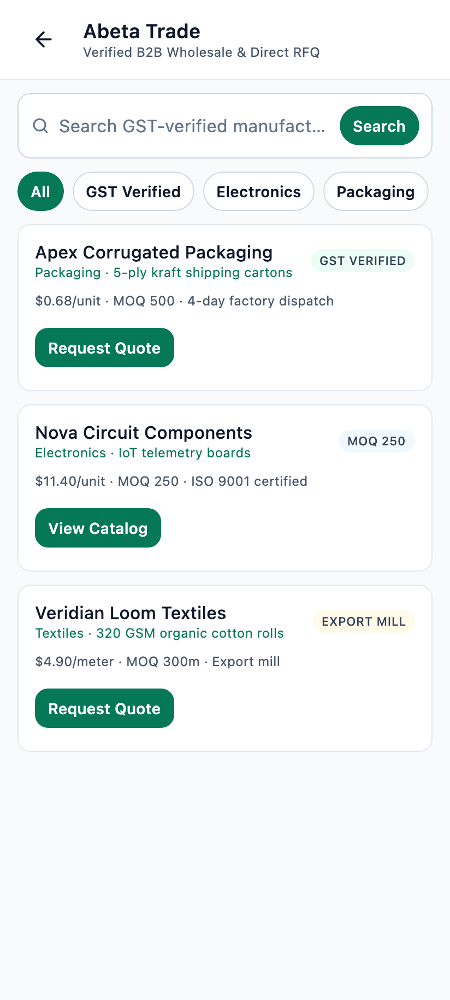

# Abeta SDUI Domain BFF (`abeta-dev/sdui-bff`)

[](https://github.com/Abeta-dev/sdui-bff/actions/workflows/ci.yml)
[](https://github.com/Abeta-dev/sdui-bff/actions/workflows/release.yml)
[](https://go.dev/)
[](llms.txt)
[](https://render.com/deploy?repo=https://github.com/Abeta-dev/sdui-bff)
[](LICENSE)

**Abeta SDUI Domain BFF** (`github.com/abeta-dev/sdui-bff`, `v0.3.0`) is a standalone **Go 1.26.0** Clean Architecture **Backend-for-Frontend (BFF)** powering **7 stateful Super-App vertical experiences** (**Abeta Fresh**, **Abeta Bites**, **Abeta Pulse**, **Abeta Mart**, **Abeta Spark**, **Abeta Trade**, and **Abeta Pay**) over Server-Driven UI (SDUI) wire contracts.

It consumes typed `v1` SDUI contracts directly from [`github.com/abeta-dev/kmp/bff@v0.5.0`](https://github.com/Abeta-dev/kmp) (**28 Wire Atoms** / **30 Compose UI Atoms** incl. `CountdownAtom` and the 12 extended production atoms `QrCode`, `OtpInput`, `Select`, `SegmentedControl`, `RadioGroup`, `Rating`, `Price`, `Badge`, `AlertBanner`, `StatTile`, `KeyValueRow`, `Chip`, **21 canonical SnippetTypes** including `swipe_deck`, `search_bar`, `chip_group`, `nudge_bar`, `marquee_strip`, `order_tracker`, and server-molded `composed_block` recipes with **29 `ComposedNodeKind`s**, **18 ActionTypes**, **7 ambient `MotionLoopEffect`s**, and **Free-Delivery threshold `FloatingCartSpec` docks**) wrapped in [`github.com/abeta-dev/go-libs@v0.4.0`](https://github.com/Abeta-dev/go-libs) `ginmw.Envelope` responses, and optionally integrates with [`Abeta-dev/layout-engine`](https://github.com/Abeta-dev/layout-engine) for dynamic CMS-managed layout hydration with automatic standalone fallback.

> **LLM & AI-Agent Ready**: Read the concise [`llmstxt.org`](https://llmstxt.org/) index in **[`llms.txt`](llms.txt)**, the full single-file reference in **[`llms-full.txt`](llms-full.txt)**, or fetch live **`GET /llms.txt`** and **`GET /llms-full.txt`** directly from any running instance (`http://localhost:8085/llms.txt`).

---

## The 3-Repo Abeta SDUI Platform

| Repository | Role | Default Port / Runtime |
| :--- | :--- | :--- |
| **[`Abeta-dev/kmp`](https://github.com/Abeta-dev/kmp)** | Kotlin Multiplatform + Compose Multiplatform SDUI Client Kit (`v0.5.0` contracts, 28 Wire Atoms / 30 Compose UI Atoms, 21 snippet renderers incl. Atomic Snippet Molding `composed_block` with 29 `ComposedNodeKind`s, 18 OCP actions, 7 ambient `MotionLoopEffect`s, `:sample-app` 7-in-1 Super-App Showcase, `:storybook` 20 stories, `:watch-companion`) | Android · iOS · macOS · Desktop JVM · WasmJS · watchOS · Wear OS |
| **[`Abeta-dev/layout-engine`](https://github.com/Abeta-dev/layout-engine)** | Multi-tenant Dynamic SDUI Layout Engine & Visual Layout Studio (rule targeting, UTC scheduling, dynamic slotting, immutable snapshots, rollback, fallback) | `:8090` (SQLite WAL or PostgreSQL 17) |
| **[`Abeta-dev/sdui-bff`](https://github.com/Abeta-dev/sdui-bff)** *(this repo)* | Stateful Multi-Vertical Domain BFF orchestrating domain state, search/filtering, interactive mutations (`follow_up_actions`), and optional Layout Engine screen composition | `:8085` (zero-dependency standalone or integrated via `LAYOUT_ENGINE_URL`) |

---

## Architecture Overview

Dependencies follow the **Uncle Bob Dependency Rule** strictly inward (`internal/domain` has zero Gin, `net/http`, handler, usecase, vertical, or infra imports — enforced in CI by `internal/domain/arch_test.go`).



---

## 7 Stateful Super-App Verticals

Each vertical is registered as an Open/Closed (`OCP`) `domain.VerticalModule` with live filtering, search, state transitions, **v0.5.0 extended production UI atoms** (`QrCode`, `OtpInput`, `Select`, `SegmentedControl`, `RadioGroup`, `Rating`, `Price`, `Badge`, `AlertBanner`, `StatTile`, `KeyValueRow`, `Chip` molded via `composed_block`), quick-commerce animations & nudges (`marquee_strip` tickers, urgency `nudge_bar` with `CountdownAtom` & ambient loops, Free-Delivery threshold `FloatingCartSpec` docks, animated 4-step `order_tracker`), and rich `follow_up_actions` (`trigger_feedback` celebrations, toasts, and navigation).

| Vertical App | Category | Tenant ID | Theme Preset | Screen Routes (`GET /api/v1/screens/:id`) | v0.5.0 Molded Atoms & Highlights | Domain Mutation Endpoints |
| :--- | :--- | :--- | :--- | :--- | :--- | :--- |
| **Abeta Fresh** | Quick-Commerce (8-Min Grocery) | `abeta-fresh` | `EMERALD` | `fresh-home`, `store-home` | `marquee_strip`, `fresh_flash_nudge` (`420s` countdown + `wiggle`), `MoldLoyaltyStampRecipe`, molded `Select` delivery slot + `KeyValueRow` savings + `Badge`, `$15` Free-Delivery cart dock | `POST /api/v1/fresh/orders/express`, `POST /api/v1/orders/express` |
| **Abeta Bites** | Food Delivery & Dining | `abeta-bites` | `AMBER` | `bites-home`, `bites-restaurant`, `bites-order-track` | `marquee_strip`, molded `Rating` + `Price` + `RadioGroup` speed + `KeyValueRow` highlights, `$18` Free Priority Delivery dock, animated 4-step `order_tracker` (`#BTS-xxxx`) | `POST /api/v1/bites/orders` |
| **Abeta Pulse** | Live Events, Movies & Experiences | `abeta-pulse` | `INDIGO` | `pulse-home`, `pulse-event-detail` | Early-bird urgency `nudge_bar` (`540s` countdown), molded `AlertBanner` + `Rating` + `QrCode` mobile e-pass preview on detail | `POST /api/v1/pulse/bookings` |
| **Abeta Mart** | Multi-Category Marketplace | `abeta-mart` | `INDIGO` | `mart-home`, `mart-product-detail` | `marquee_strip`, `MoldFlashDealRecipe`, molded `Price` (MRP + discount pill) + `Rating` + `Chip` + `KeyValueRow` highlights, `$25` Free-Delivery cart dock | `POST /api/v1/mart/orders` |
| **Abeta Spark** | Swipe Discovery & Matchmaking | `abeta-spark` | `AMBER` | `spark-deck`, `spark-matches` | Prime Boost `nudge_bar` (`heartbeat` badge), interactive `swipe_deck`, live match persistence | `POST /api/v1/spark/swipe` |
| **Abeta Trade** | B2B Wholesale & RFQ Procurement | `abeta-trade` | `EMERALD` | `trade-home`, `trade-supplier` | Molded MOQ Bulk Savings `composed_block` (`RollingCounter` + `StatTile` telemetry), landed-cost `StatTile` + `KeyValueRow` breakdown on RFQ screen | `POST /api/v1/trade/rfq` |
| **Abeta Pay** | Fintech Wallet & Smart Cards | `abeta-pay` | `INDIGO` | `pay-home`, `pay-transfer`, `pay-cards`, `pay-receipt` | Balance/cashback `StatTile`s, `MarqueeStrip`, live `#PAY-3081` `OrderTracker`, scan-to-pay `QrCode` + `Chip`, `SegmentedControl` + `RadioGroup` + masked 4-digit `OtpInput` + `KeyValueRow` transfer flow, card `Badge` + `AlertBanner` controls, itemized receipt + OS `share` | `POST /api/v1/pay/transfers`, `POST /api/v1/pay/cards/controls` |

### Core Discovery, Action & Ops Endpoints
- `GET /api/v1/apps` — Super-App catalog describing all 7 vertical apps
- `GET /api/v1/screens` — List all 17 discoverable screen routes across all 7 verticals
- `GET /api/v1/screens/:screenId` — Fetch a `v1` `PageResponse` (supports `?q=`, `?filter=`, `?city=`, `?id=`, `?cursor=`, and `X-Tenant-ID`, `X-Platform`, `X-City`, `X-User-Segment`, `X-Window-Class`)
- `POST /api/v1/actions/execute` — Execute generic SDUI actions and return `follow_up_actions`
- `GET /llms.txt` & `GET /llms-full.txt` — Live plain-text `llmstxt.org` AI-agent documentation served from embedded repo files
- `GET /openapi.json` & `GET /docs` — Live OpenAPI 3.1 schema and interactive Scalar API documentation
- `GET /healthz` & `GET /readyz` — Liveness and readiness probes

---

## Visual 6-App Live Showcase

Every screenshot below was rendered live by `Abeta-dev/kmp` (`:sample-app`) consuming `v1` SDUI payloads directly from `Abeta-dev/sdui-bff` (`:8085`) across adaptive Desktop (`Expanded`) and Phone (`Compact`) viewports.

### Adaptive Desktop Layout (`Expanded` — Abeta Fresh)



### All 6 Stateful Verticals (`Compact` Phone Layouts)

<table>
  <tr>
    <td align="center" width="33%">
      <br />
      <strong>Abeta Fresh</strong><br />
      <sub>Quick-Commerce Grocery (<code>fresh-home</code>)</sub>
    </td>
    <td align="center" width="33%">
      <br />
      <strong>Abeta Bites</strong><br />
      <sub>Food Delivery &amp; Prep Track (<code>bites-home</code>)</sub>
    </td>
    <td align="center" width="33%">
      <br />
      <strong>Abeta Pulse</strong><br />
      <sub>Events, Cinema &amp; Dining (<code>pulse-home</code>)</sub>
    </td>
  </tr>
  <tr>
    <td align="center" width="33%">
      <br />
      <strong>Abeta Mart</strong><br />
      <sub>Multi-Category Marketplace (<code>mart-home</code>)</sub>
    </td>
    <td align="center" width="33%">
      <br />
      <strong>Abeta Spark</strong><br />
      <sub>Interactive Swipe Discovery (<code>spark-deck</code>)</sub>
    </td>
    <td align="center" width="33%">
      <br />
      <strong>Abeta Trade</strong><br />
      <sub>B2B Wholesale &amp; RFQ (<code>trade-home</code>)</sub>
    </td>
  </tr>
</table>

---

## Quick Start

### Mode 1: Standalone (Zero External Dependencies)

Requires only **Go 1.26.0** — no Docker, PostgreSQL, or Layout Engine needed:

```bash
git clone https://github.com/Abeta-dev/sdui-bff.git
cd sdui-bff
go run ./cmd/sdui-bff
```

The BFF starts on **`:8085`** with all 7 stateful verticals ready immediately:

```bash
curl http://localhost:8085/healthz
curl http://localhost:8085/api/v1/apps
curl "http://localhost:8085/api/v1/screens/fresh-home?city=Bengaluru"
curl "http://localhost:8085/api/v1/screens/pay-home"
```

### Mode 2: Connected to Local `Abeta-dev/layout-engine`

Start `Abeta-dev/layout-engine` on `:8090`, then run `sdui-bff` pointing to it:

```bash
LAYOUT_ENGINE_URL=http://localhost:8090 go run ./cmd/sdui-bff
# or via Makefile:
make run-with-layout-engine
```

When `LAYOUT_ENGINE_URL` is set, `sdui-bff` queries the Layout Engine first (forwarding `X-Tenant-ID`, `X-Platform`, `X-City`, `X-User-Segment`, and `X-Window-Class`) and falls back gracefully to standalone vertical rendering on `404`, timeout, or network error.

### Mode 3: Full 3-Service Platform Stack (Docker Compose)

Launch **PostgreSQL 17** + **`Abeta-dev/layout-engine` (`:8090`)** + **`Abeta-dev/sdui-bff` (`:8085`)** together:

```bash
docker compose up --build
```

- **SDUI BFF API**: [http://localhost:8085/docs](http://localhost:8085/docs)
- **Layout Engine Visual Studio**: [http://localhost:8090/studio](http://localhost:8090/studio)

---

## Connecting `Abeta-dev/kmp` (`sample-app`)

Launch the `Abeta-dev/kmp` 7-in-1 Super-App Showcase pointed directly at `sdui-bff`:

```bash
(cd ../kmp/kmp && ./gradlew :sample-app:run --args="--bff-url=http://localhost:8085")
```

Run headless end-to-end verification across all 7 verticals:

```bash
(cd ../kmp/kmp && ./gradlew :sample-app:run --args="--headless --bff-url=http://localhost:8085")
```

---

## Configuration

Copy [.env.example](.env.example) to `.env` for local overrides:

| Variable | Default | Description |
| :--- | :--- | :--- |
| `PORT` | `8085` | HTTP server listen port |
| `GIN_MODE` | `release` | Gin mode (`release`, `debug`, `test`) |
| `LAYOUT_ENGINE_URL` | *(empty)* | Optional `Abeta-dev/layout-engine` base URL (e.g. `http://localhost:8090`) |
| `LOG_LEVEL` | `info` | Structured log verbosity (`debug`, `info`, `warn`, `error`) |
| `JWT_SECRET` | *(empty)* | Optional HS256 JWT secret enabling bearer auth middleware when set |
| `RATE_LIMIT_RPS` | `0` | Optional global rate limit (requests/sec); `0` disables throttling |

---

## Development & Verification

```bash
make run                     # Start standalone on :8085
make run-with-layout-engine  # Start on :8085 wired to http://localhost:8090
make test                    # Run go test -count=1 -race -cover ./...
make vet                     # Run go vet ./...
make fmt                     # Format Go sources with gofmt
make verify                  # Run full ./scripts/verify_all.sh pipeline
make docker-build            # Build local distroless OCI image
make docker-up               # Start full 3-service Compose stack
```

---

## Documentation & AI Agent Guides

- [llms.txt](llms.txt) · [llms-full.txt](llms-full.txt) — `llmstxt.org` AI-agent index and complete single-file technical reference (also served live at `GET /llms.txt` and `GET /llms-full.txt`)
- [docs/architecture.md](docs/architecture.md) — Clean Architecture layers, `VerticalModule` OCP design, Layout Engine hydration, and KMP wire invariants
- [docs/verticals-guide.md](docs/verticals-guide.md) — Deep guide to all 7 stateful vertical apps, endpoints, interactive snippets, molded v0.5.0 atoms, and adding new verticals
- [AGENTS.md](AGENTS.md) · [CLAUDE.md](CLAUDE.md) · [GEMINI.md](GEMINI.md) — Multi-IDE AI coding agent contracts and verification gates
- [skills/abeta-sdui-bff/SKILL.md](skills/abeta-sdui-bff/SKILL.md) · [agents/bff-engineer.md](agents/bff-engineer.md) — Domain engineering skill and Code Owner persona
- [LICENSE](LICENSE) — Apache License 2.0
