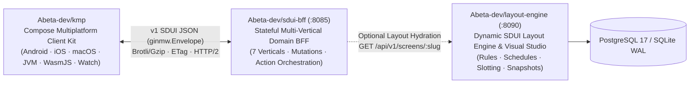
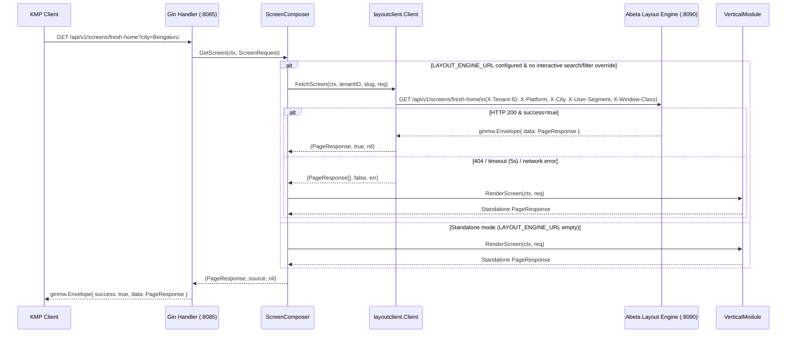

# Architecture — Abeta SDUI Domain BFF (`abeta-dev/sdui-bff`)

This document describes the Clean Architecture boundaries, 3-repo Abeta SDUI Platform integration, Open/Closed (`OCP`) `VerticalModule` pattern, optional `Abeta-dev/layout-engine` hydration pipeline, and KMP wire-contract invariants of **`github.com/abeta-dev/sdui-bff`**.

---

## 1. The 3-Repo Abeta SDUI Platform

`abeta-dev/sdui-bff` is the stateful domain orchestration layer of the 3-repository Abeta SDUI Platform:



| Responsibility | Owner Repo |
| :--- | :--- |
| Typed wire contracts (`29` Wire Atoms / `31` Compose UI Atoms / `36` `ComposedNodeKind`s, `21` SnippetTypes, `18` ActionTypes, `7` ambient `MotionLoopEffect`s, Express `molecules`, `EnsureComponentIDs`, shared `analytics` DTOs), Compose renderers, offline cache, haptic & platform bridges | `Abeta-dev/kmp` (`github.com/abeta-dev/kmp/bff@v0.6.0`) |
| Dynamic CMS authoring, multi-tenant targeting rules, UTC schedule windows, slotting, immutable snapshots, rollback, Visual Layout Studio (`/studio`) | `Abeta-dev/layout-engine` |
| Stateful domain catalogs, search & category filtering, cart/order/booking/swipe/RFQ/transfer/card-control state transitions, `follow_up_actions` orchestration, deterministic `EnsureComponentIDs`, batched analytics ingestion (`POST /api/v1/analytics/events` & `GET /api/v1/analytics/summary`), and optional Layout Engine composition | `Abeta-dev/sdui-bff` (`v0.4.0`) |

---

## 2. Clean Architecture Layering

Dependencies strictly obey the **Uncle Bob Dependency Rule**, flowing inward toward `internal/domain`:

```text
sdui-bff/
├── cmd/sdui-bff/               # Entrypoint, env config, OCP vertical registration, HTTP/2 & h2c server, graceful shutdown
├── internal/
│   ├── domain/                 # Pure entities, sentinel errors & port interfaces + arch_test.go
│   ├── usecase/                # ScreenComposer (EnsureComponentIDs + Layout Engine + Fallback), ActionExecutor, AnalyticsService
│   ├── handler/                # Gin router, vertical & analytics endpoints, OpenAPI 3.1 (/openapi.json, /docs), Brotli/Gzip, ETag, health
│   ├── infra/
│   │   ├── analyticsstore/     # Thread-safe in-memory AnalyticsStore (dimension counters + 100-event ring buffer)
│   │   └── layoutclient/       # Optional HTTP client for Abeta-dev/layout-engine implementing domain.LayoutEngineClient
│   └── verticals/              # 7 OCP VerticalModule implementations (fresh, bites, pulse, mart, spark, trade, pay)
├── scripts/                    # check_brand_hygiene.sh, verify_all.sh
├── docs/                       # architecture.md, verticals-guide.md
├── skills/abeta-sdui-bff/      # SKILL.md domain engineering playbook
├── agents/                     # bff-engineer.md Code Owner persona
└── .github/workflows/          # ci.yml (4 checks + unified CI Quality Gate) & release.yml (cross-platform binaries + multi-arch GHCR)
```

### Automated Architectural Guard (`internal/domain/arch_test.go`)

`internal/domain/arch_test.go` parses every non-test Go file in `internal/domain` via `go/parser` and fails `go test ./...` if `internal/domain` imports any forbidden package:
- `github.com/gin-gonic/gin`
- `net/http`
- `github.com/abeta-dev/sdui-bff/internal/handler`
- `github.com/abeta-dev/sdui-bff/internal/infra`
- `github.com/abeta-dev/sdui-bff/internal/usecase`
- `github.com/abeta-dev/sdui-bff/internal/verticals`

---

## 3. Core Domain Ports (`internal/domain/ports.go`)

All cross-layer boundaries are defined as narrow Go interfaces in `internal/domain`:

1. **`VerticalModule`** — Open/Closed Strategy port implemented by each vertical app:
   - `Descriptor() AppDescriptor`
   - `Screens() []ScreenSummary`
   - `CanHandleScreen(screenID string) bool`
   - `RenderScreen(ctx context.Context, req ScreenRequest) (snippets.PageResponse, error)`
2. **`LayoutEngineClient`** — Optional CMS layout integration port implemented by `internal/infra/layoutclient.Client`:
   - `Enabled() bool`
   - `FetchScreen(ctx context.Context, tenantID, screenSlug string, req ScreenRequest) (snippets.PageResponse, bool, error)`
   - `HealthCheck(ctx context.Context) bool`
3. **`ScreenComposer`** — Orchestrates app catalog listing, screen discovery, and dual-mode screen rendering (`GetScreen` returning `(PageResponse, sourceTag, error)` normalized via `snippets.EnsureComponentIDs`).
4. **`ActionExecutor`** — Handles generic `POST /api/v1/actions/execute` actions and produces `ActionResult` payloads with typed `follow_up_actions`.
5. **`AnalyticsStore` & `AnalyticsService`** — Persist and enrich batched SDUI client telemetry (`POST /api/v1/analytics/events`) and expose live counters by `event_name`, `category`, `page_id`, `component_id` plus a bounded 100-event ring buffer (`GET /api/v1/analytics/summary`).

---

## 4. Dual-Mode Resolution: Standalone vs. Layout Engine Hydrated

`internal/infra/layoutclient.Client` lets `sdui-bff` operate seamlessly in two modes without changing client code:



### Layout Client Safety Bounds
- **No-op standalone mode**: Empty/whitespace `LAYOUT_ENGINE_URL` yields `Enabled() == false` with zero outbound HTTP calls.
- **Bounded timeouts**: `5s` default screen request timeout and `1.5s` `/healthz` readiness probe timeout.
- **Payload safety bound**: `io.LimitReader(resp.Body, 4<<20)` (4 MiB cap) guards memory against oversized upstream payloads.
- **Targeting propagation**: Forwards `X-Tenant-ID`, `X-Platform`, `X-City`, `X-User-Segment`, and `X-Window-Class` verbatim.

---

## 5. KMP Wire Protocol & Tracking Invariants (`v0.6.0`)

1. **Direct Contract Reuse**:
   - Import `github.com/abeta-dev/kmp/bff/pkg/sdui/{actions,analytics,atoms,molecules,snippets,theming}` (`v0.6.0`) directly rather than duplicating JSON structs.
   - Supports all **29 Wire Atoms** / **31 Compose UI Atoms** (incl. `CountdownAtom`, `MediaPagerAtom`, and the 12 extended production atoms `QrCode`, `OtpInput`, `Select`, `SegmentedControl`, `RadioGroup`, `Rating`, `Price`, `Badge`, `AlertBanner`, `StatTile`, `KeyValueRow`, `Chip`), **21 SnippetTypes** (including sticky `search_bar`, interactive `swipe_deck`, `chip_group`, plus `nudge_bar`, `marquee_strip`, `order_tracker`, and server-molded `composed_block` with **36 `ComposedNodeKind`s** plus reusable Express Quick-Commerce `molecules`), **18 ActionTypes**, **7 ambient `MotionLoopEffect`s**, and Free-Delivery threshold `FloatingCartSpec` docks.
   - `DefaultScreenComposer.GetScreen` invokes `snippets.EnsureComponentIDs(&page)` on every returned page (standalone and Layout Engine hydrated) to guarantee stable, deterministic component identifiers for analytics attribution.
2. **Envelope Wrapping**:
   - Every `/api/v1/*` response uses `github.com/abeta-dev/go-libs@v0.4.0` `ginmw.Envelope` (`{"success": true, "data": ...}` or structured error details).
3. **KMP String-Only Tracking Property Rule (Non-Negotiable)**:
   - On the Kotlin Multiplatform client (`abeta-dev/kmp`), `TrackingContract.properties` is typed as `Map<String, String>` under strict `kotlinx.serialization`.
   - Every tracking/analytics property map emitted from `sdui-bff` **must contain string values only** (`map[string]string`). Never encode integers, floats, booleans, or nested objects inside tracking properties (convert with `strconv.Itoa` / `strconv.FormatBool` if needed).
4. **Action Follow-Up Chaining & Analytics Telemetry**:
   - Mutation endpoints (`/api/v1/fresh/orders/express`, `/api/v1/bites/orders`, `/api/v1/pulse/bookings`, `/api/v1/mart/orders`, `/api/v1/spark/swipe`, `/api/v1/trade/rfq`, `/api/v1/pay/transfers`, `/api/v1/pay/cards/controls`, `/api/v1/orders/express`, `/api/v1/actions/execute`) return `domain.ActionResult` with `follow_up_actions` (`trigger_feedback`, `show_toast`, `navigate`, `track_event`). The KMP `RemoteApiCallExecutor` dispatches these follow-up actions automatically.
   - Telemetry endpoints (`POST /api/v1/analytics/events` & `GET /api/v1/analytics/summary`) ingest batched `page_open`, `snippet_impression`, `node_impression`, `interaction_click`, and `track_event` records and expose real-time counters.

---

## 6. Concurrency, Transport & Security

- **Thread-Safe Vertical & Analytics State**: Each vertical and `internal/infra/analyticsstore.InMemoryStore` protect mutable state with `sync.RWMutex`. Every test suite runs under `go test -count=1 -race -cover ./...`.
- **HTTP Transport**: Supports HTTP/1.1 + `h2c` (HTTP/2 cleartext), negotiated Brotli (`br`) and gzip response compression, and SHA-256 `ETag` / `304 Not Modified` caching.
- **Security Controls & CI Quality Gate**:
  - Optional HS256 JWT authentication (`JWT_SECRET`) and global request rate limiting (`RATE_LIMIT_RPS`).
  - Container image built on `gcr.io/distroless/static-debian12:nonroot` running as `nonroot:nonroot` with `CGO_ENABLED=0`.
  - CI runs brand/path hygiene checks, SHA-256-verified MIT `gitleaks` CLI `v8.30.1`, race-enabled coverage tests, static binary build, and OCI image verification behind a unified **`CI Quality Gate`** (`ci-quality-gate`) aggregator job.
